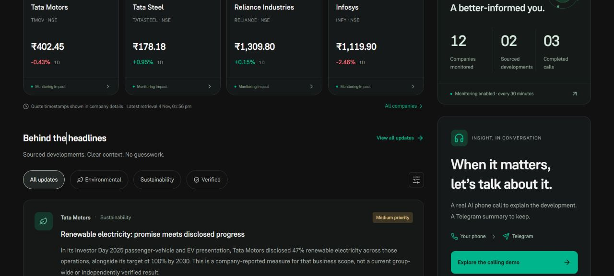
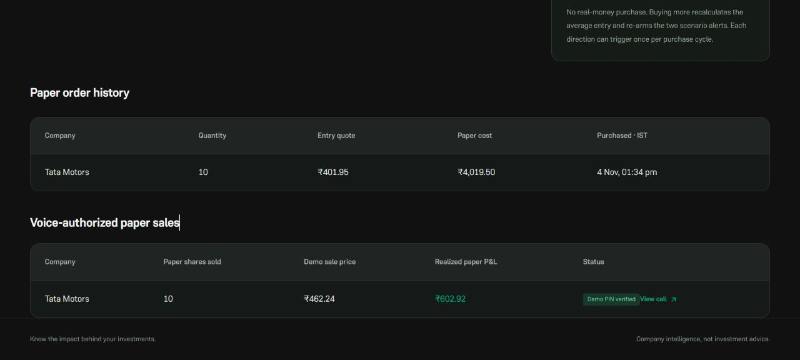
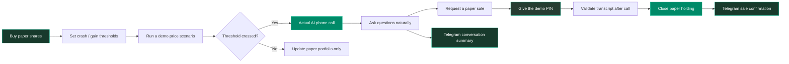
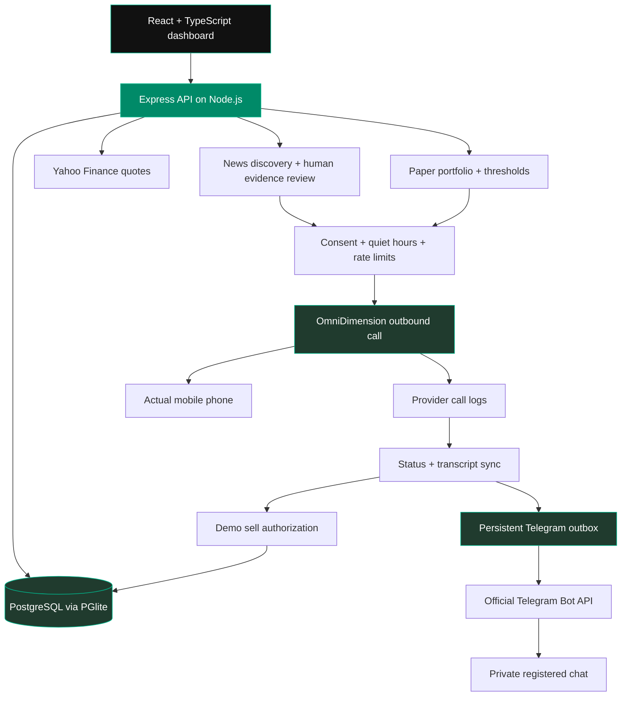

<div align="center">


<br/>


<br/>


<br/>

**[The idea](#-the-idea) · [Features](#-what-we-built) · [Demo flow](#-the-demo-journey) · [Architecture](#-how-it-works) · [Quick start](#-run-it-locally) · [Team BB](#-team-bb)**

</div>

---

<div align="center">
<table>
<tr>
<td align="center" width="26%"><br/><strong>VIPS-TC</strong></td>
<td align="center" width="74%"></td>
</tr>
</table>

### Built by Team BB for ProdVerse ~ Tech Unbound

**Tanish Aggarwal & Palak Gupta · VIPS-TC**
</div>

---

## 💡 The idea

A watchlist can show a number. A conversation can explain why it deserves your attention.

**Stock Calling** combines a dark Indian equities dashboard, a paper portfolio, company-impact research, real conversational AI phone calls and Telegram follow-ups. Buy paper shares, choose your alert thresholds, and try a crash or gain scenario. When the threshold is crossed, your actual phone rings. Ask questions naturally in English, Hindi or Hinglish; the conversation and its outcome are saved in the dashboard.

A demo sale can also happen through the conversation: ask to sell, provide your **demo PIN**, and the backend closes the paper holding after validating the actual transcript.

> **The boundary is clear:** market quotes come from a real provider; paper purchases and scenario price movements are demonstrations. Phone calls and Telegram deliveries use real provider APIs. There is no real-money brokerage trading.

## ✨ What we built

| Feature | What it does |
|---|---|
| 📈 **Indian market dashboard** | Genuine last-available quotes for 12 companies, NIFTY 50, SENSEX and BANK NIFTY, with quote timestamps and delay notices. |
| 🛒 **Paper portfolio** | Buy paper shares from a provider quote, maintain weighted average entry prices, and persist positions and order history. |
| 📉 **Crash & gain scenarios** | Set fall/gain thresholds and run controlled scenarios without changing the real market quote. |
| 📞 **Real AI phone calls** | OmniDimension dials the registered phone and explains the supplied alert context in a two-way conversation. |
| 🔐 **Voice-authorized paper sale** | Accept a sell offer or request a sale, give the demo PIN, and close the paper holding after the call. |
| ✈️ **Telegram follow-up** | Register a private bot chat and receive actual conversation summaries, source links, call outcomes and sale confirmations. |
| 🌱 **Company-impact intelligence** | Sourced disclosures, categories, verification labels and promise-versus-progress timelines. |
| 🔎 **Research discovery & review** | Discover recent news leads; human evidence review is required before a research lead becomes eligible for priority calls. |
| 🛡️ **Consent & call controls** | Registered-number consent, India quiet hours, a daily call limit and a minimum interval between attempts. |
| 🗂️ **Persistent history** | PostgreSQL-backed calls, transcripts, messages, paper orders, positions, alerts and sale records. |

## 🖥️ A look inside

<div align="center">

<br/><br/>

</div>

<sub>Screenshots are from the working local app. Market quotes are time-specific; portfolio scenario values are paper/demo values.</sub>

## 🎬 The demo journey



**Example conversation**

> **AI:** “In your demo portfolio, Tata Motors has moved beyond your alert threshold. Would you like me to explain the numbers?”<br/>
> **You:** “Sell my holding.”<br/>
> **AI:** “Please tell me your four-digit demo PIN, one digit at a time.”<br/>
> **You:** Provide the configured demo PIN.<br/>
> **AI:** “PIN verified. Your request to sell the demo shares will be processed after this call.”

The backend verifies the actual user turns independently. A sell request or affirmative acceptance, a PIN prompt and the correct user-spoken digits are required. Wrong PINs, cancellations, agent-spoken digits and changed holdings do not authorize a sale. Reprocessing the same call cannot execute a second sale. PIN entries are redacted in locally saved transcripts.

### What was actually verified

- An actual phone call completed for a Tata Motors company disclosure, with a real conversation transcript.
- A **−10% paper-price scenario** triggered a completed crash-alert call and a delivered Telegram summary.
- A **+15% paper-price scenario** triggered a completed gain-alert call.
- The user accepted the sell offer and spoke the demo PIN across four separate turns; the backend closed all **10 paper shares** once and delivered the sale confirmation through Telegram.
- The UI, paper ledger and call/message history reflected the outcomes.

These live checks are separate from the automated tests. Calls require your own provider account, credits, consent and working network access.

## 🧩 How it works



### Evidence and delivery rules

| Situation | Behaviour |
|---|---|
| Reviewed, recent **high-priority company development** | Eligible for a consented call; Telegram follows the provider outcome. |
| Reviewed, recent **medium-priority commitment** | Telegram notification when monitoring and consent are enabled. |
| Routine update or unreviewed headline | Dashboard/research only; no automatic call. |
| User-requested paper-price scenario crosses a threshold | Real demo call, with explicitly demo-portfolio context. |
| Repeated scenario in the same direction/purchase cycle | No duplicate call. |
| Call request accepted but no result yet | Remains dispatched; never shown as completed. |
| Telegram API rate limit | Bounded retry with backoff. |
| Delivery outcome is uncertain | Marked unknown; not blindly resent. |

Call results are polled every **20 seconds** using the provider's call-log API, correlated by request ID/metadata. No public webhook or inbound exposure of the laptop is needed. Optional research monitoring runs every **30 minutes** while the server is running.

## 🛠️ Technology stack

| Layer | Technology |
|---|---|
| Frontend | React 19 · TypeScript · Vite 7 |
| Interface | Tailwind CSS 4 · Lucide icons · responsive dark theme |
| Backend | Node.js 24 · Express 5 · Zod · Helmet · express-rate-limit |
| Database | PGlite: an embedded PostgreSQL engine compiled to WASM |
| Voice | OmniDimension outbound calling and call-log API |
| Messaging | Official Telegram Bot API |
| Market quotes | Yahoo Finance chart endpoint |
| Research | Google News RSS discovery + original-source human review |
| Verification | Node test runner through `tsx` · TypeScript build · GitHub Actions |

### Companies included

Tata Motors · Tata Steel · Reliance Industries · Mahindra & Mahindra · Infosys · Wipro · HDFC Bank · ICICI Bank · Adani Enterprises · ITC · Larsen & Toubro · Maruti Suzuki.

Tata Motors uses the current **TMCV** listing. Historical passenger-vehicle/group disclosures carry their business scope; they are not silently attributed to the current commercial-vehicle entity.

## 🚀 Run it locally

**Requirements:** Node.js 24, npm, an OmniDimension account with outbound calling access/credits, and a Telegram bot created with [BotFather](https://t.me/BotFather).

```bash
git clone https://github.com/TanishAggarwall/Groww-Stock-Calling.git
cd Groww-Stock-Calling
npm ci
```

Create the local configuration:

```powershell
# Windows PowerShell
Copy-Item .env.example .env.local
```

```bash
# macOS / Linux
cp .env.example .env.local
```

Fill in `.env.local`:

```dotenv
PORT=3000
APP_URL=http://localhost:3000
OMNIDIM_API_KEY=your_own_omnidimension_api_key
OMNIDIM_AGENT_ID=
TELEGRAM_BOT_TOKEN=your_own_botfather_token
TELEGRAM_BOT_USERNAME=your_bot_username_without_at
DEMO_SELL_PIN=your_own_four_digit_demo_pin
```

Then start the app:

```bash
npm run build
npm start
```

Open **http://localhost:3000**. For frontend hot reloading, use `npm run dev`; restart the server after backend changes.

No separate PostgreSQL service is required. The local database is initialized automatically under `data/postgres`.

### Connect the integrations

1. Open **Settings & integrations** and enter your own registered phone number.
2. Enable call consent; choose quiet hours, categories and the daily call limit.
3. Save the OmniDimension API key, check the connection and configure the voice agent. The agent ID is saved server-side.
4. Save the Telegram token and enable messaging consent.
5. Open the unique private registration link in Telegram and tap **Start**. Registration checks run automatically; only a matching private-chat start code can pair the workspace.
6. Send a Telegram test and use **Portfolio / Holdings** to buy paper shares and try a price scenario.

The server binds to **127.0.0.1** for this single-user local demo. Keep it running for monitoring, transcript sync and queued Telegram delivery. The localhost link in Telegram opens on the laptop; it is not a remotely hosted deployment.

<details>
<summary><strong>Configuration reference</strong></summary>

| Variable | Purpose |
|---|---|
| `PORT` | Local API/UI port; defaults to `3000`. |
| `APP_URL` | Dashboard URL included in notifications. |
| `OMNIDIM_API_KEY` | Server-side voice-provider credential. |
| `OMNIDIM_AGENT_ID` | Created/configured voice agent; may be left blank initially. |
| `TELEGRAM_BOT_TOKEN` | Server-side BotFather token. |
| `TELEGRAM_BOT_USERNAME` | Bot username used to construct the registration link when the API is unavailable. |
| `DEMO_SELL_PIN` | Four-digit passcode used only for demo paper sales. |

Actual credentials, registered phone/chat details, local databases, private transcripts and diagnostic scripts are excluded from Git. Use a demo passcode, never a real brokerage PIN. If Telegram API connections are reset on a network, use a network/VPN that can reach `api.telegram.org`.

</details>

## ✅ Tests & checks

```bash
npm test
npm run build
```

**Six automated tests** cover:

- India quiet-hour boundaries and consent/verification gates.
- Provider dispatch, correlation, actual-transcript summaries and Telegram delivery deduplication using mocked provider contracts.
- Secure private-chat registration, rate-limit backoff and uncertain-send handling.
- Idempotent paper purchases, threshold boundaries, separate crash/gain alerts and preservation of real quotes.
- Demo PIN authorization in one turn or successive turns, affirmative sell-offer acceptance, cancellation, wrong PINs, stale holdings and exactly-once paper sales.

The [GitHub Actions workflow](.github/workflows/ci.yml) runs the test suite and production build without live provider credentials.

## 📂 Project structure

```text
Groww-Stock-Calling/
├── .github/workflows/ci.yml   # Build and test pipeline
├── docs/                     # Team artwork, app previews and asset credits
├── public/
│   ├── fonts/                # Reference typography
│   └── logos/                # Listed-company logos
├── server/
│   ├── index.ts              # Local API and application server
│   ├── db.ts                 # PostgreSQL schema and persistence
│   ├── market.ts             # Genuine market quotes and cache
│   ├── monitor.ts            # Research discovery and alert routing
│   ├── integrations.ts       # Voice calls, transcript sync and Telegram outbox
│   ├── portfolio.ts          # Paper purchases and scenario thresholds
│   ├── paper-sell.ts         # Transcript-based demo sale authorization
│   ├── policy.ts             # Consent, quiet hours and outcome rules
│   └── catalog.ts            # Company catalogue and sourced disclosures
├── src/
│   ├── main.tsx              # Application screens and interactions
│   └── style.css             # Responsive dark dashboard
├── tests/                    # Six workflow/property tests
├── .env.example              # Configuration template, no real credentials
└── README.md
```

## 🧭 Current scope

This is a working **single-user hackathon application**. Paper-price scenarios are manually triggered; continuous live-price threshold monitoring and real-money brokerage execution are not implemented. Research discovery is not an exhaustive ESG service: new headlines need original-source human review before priority routing. Quotes may be delayed, stale or unavailable, and the UI labels that status. Provider credits, network connectivity and consent controls determine call availability.

The design is Groww-inspired, with original application flows. Company logos, the reference font, institution/event artwork and other third-party materials retain their owners' rights; see [asset credits](docs/ASSETS.md). This is an independent student project, not an official Groww integration.

## 👥 Team BB

<div align="center">

| Team member | Institution |
|:---:|:---:|
| **Tanish Aggarwal** | VIPS-TC |
| **Palak Gupta** | VIPS-TC |

**Competition:** ProdVerse ~ Tech Unbound<br/>
**Team:** Team BB<br/>
**Built around one idea:** a portfolio alert should be a conversation you can understand and act on in a demo.

<br/>

[](https://github.com/TanishAggarwall/Groww-Stock-Calling)


</div>
